# Лабораторная работа 2
## День 1
Итак, в этой лабораторной перед нами стояла задача завернуть сервис из лабы 1 в докер и поднять его. Но ради этого сначала нужно было поставить докер. Как это просто - подумали мы. Как бы не так - ответил Докер. 


Оказалось, что Докер работает на основе Windows Subsystem for Linux - WSL2. И чтобы поставить Докер, нужно правильно поставить WSL (качаем файл wsl_update_x64.msi с сайта Microsoft). ТА также включить на компьютере компоненты виртуализации нужные для работы подсистемы, так как Докер стоит на легкой виртуальной машине внутри которой Линукс. Это было сделано командой ниже -


Дальше, после того, как была отпразднована успешная установка Докера, был написан плохой докерфайл. Так как у нас бэк и фронт - два отдельных сервиса, общающихся между собой по установленному порту, то для них были написаны два разных докерфайла. Мы решили продемонстрировать bad practices и исправить их на докерфайле бэкэнда. Так было сделано из-за того, что фронт — это статика, и большинство bad practices (слои, кеш зависимостей, multi-stage для компиляции) к нему не применяются. Выбранные Bad Practices в основном заавязаны на одной чудесной привычке докера - он запускает снова команду, только если либо изменилась сама команда, либо если до команды что-то изменилось. Если это не так, то он просто берет то, что лежит у него в кэше. А лежать там может разное, в том числе и не очень хорошое. Вот как выглядел плохой файл:

```dockerfile
FROM python:latest
WORKDIR /app
COPY . .
RUN apt-get update 
RUN apt-get install -y curl vim git build-essential libpq-dev
RUN pip install -r requirements.txt
ENV DATABASE_URL=postgresql+psycopg://postgres:yourpassword@db:5432/notes_service
ENV SECRET_KEY=super-secret-123
ENV POSTGRES_PASSWORD=yourpassword
EXPOSE 5100
CMD flask --app run.py run --port 5100
```
Первая плохая практика - не указывать версию питона. Это плохо, так как это значит, если "самая новая" версия питона по мнению Докера изменится (а она обязательно изменится), то код программы может не запуститься из-за устаревания. 

Вторая плохая практика - копировать абсолютно ВСЕ, что докер видит внутрь контейнера, даже такие ненужные вещи как .gitignore, .env, .venv и прочие интересные вещи, ибо .dockerignore в момент написания bad practices не бьло. (3 строчка)

Третья - просто убийственная связка get-update (берет список свежих пакетов просто и передает вниз установщику) и install (берет версии из списка и ставит). Порочный круг завязан на той самой чудесной привычке Докера заново перезапускать команду только в определенных случаях. Ужас начинается так: мы написали наше приложение заметок и забыли о нем на год. А через год вернулись и решили добавить потрясных новых фич, ради которых добавили в инсталл еще 1 новый пакет. Запускаем докер. Докер смотрит на команду апдейта. Команда сама не изменилась, до нее не изменилось ничего. Значит, решает он, еще раз запускать не будем. Инсталл в кои веки запускается и берет из листа выше версии пакетов. Пытается их скачать, но тщетно, ибо те самые старые версии пакетов больше не поддерживаются и их нету нигде. Ура, все упало! 

Четвертая - использование пип инсталл ПОСЛЕ копирования всего кода. Так как Докер работает слоями, то изменение одной-единственной строчки кода (!) будет считано как изменение в самом нижнем слое и Докер перезапустит все после него - значит, пип инсталл будет заново происходить после КАЖДОГО изменения кода.

Пятая - гениальное решение выставить на всеобщее обозрение ключей-паролей от Постгрес. Для верности записав их конечно в ENV, чтобы любой более-менее сведущий пользователь мог откопать их в кэше Докера через docker inspect + docker history после того, как кто-то, ужаснувштсь, их сотрет из докерфайла. 

Шестая - безобидно выглядящая последняя строчка на самом деле - вишенка на торте саботажа. Эта строчка написана так, что бедному Докеру придется запускать приложение не напрямую, а через shell. Выглядит это так - Докер разворачивает Шелл, а Шелл разворачивает Флэск. Можно было бы подумать, что все на этом благополучно работает, и слава богу, но сработает оно ровно один раз. До первой остановки Докера.
Остановим Докер. У Докера есть 2 протокола остановки - SIGTERM ("стоп по-хорошему") и SIGKILL (стоп по-плохому). По умолчанию Докер посылает своему процессу номер 1 сначала SIGTERM, ждет 10 секунд и кидает SIGKILL. А при последней команде процесс № 1 для него - это Шелл, а не сам Флэск. Итак, Докер говорит Шеллу остановиться корректно, ждет 10 секунд и все грубо закрывает, если он отказывается останавливаться. А Шелл Флэску команду остановиться не передаст, а значит, флэск будет крутиться.
И значит, все будет обречено на скоропостижную смерть через 10 секунд по SIGKILL. Прощайте, данные из БД и прочие изменения, подлежащие сохранению. 

Седьмая - К тому же, приложение из=за последней строчки просто не будет работать корректно. Из-за той же привязки к Шелл, порт, проброшеный в докере, просто не дойдет до Флэска, т.к. по умолчанию порт, на котором слушает Флэск не совпадает с портом Докера.

Запускаем командой из терминала -
```shell
cd backend
docker build -f dockerfile.bad_backend -t notes-backend:bad .  
```


Сделаем замеры по времени и памяти, чтобы потом сравнить с хорошим файлом.  

```shell
$badStart = Get-Date
docker build -f dockerfile.bad_backend -t notes-backend:bad . 
$badFirst = ((Get-Date) - $badStart).TotalSeconds
Write-Host "`nBAD first assembly: $badFirst sec" 
```
Плохой докерфайл, конечно, плохой, но в принципе запускается, хотя его сборка занимает устрашающие 5 минут и 1.8 GB (!!!) памяти.


Исправим одну строчку кода в run.py - добавим комментарий и замерим время.

```shell
$s = Get-Date
docker build -f dockerfile.bad_backend -t notes-backend:bad . 
$badRe = ((Get-Date) - $s).TotalSeconds
Write-Host "`nBAD second assembly: $badRe sec" 
```


89 секунд с кэшем - неплохо. Далее был написан хороший Докерфайл.

```dockerfile
FROM python:3.14-slim
WORKDIR /app
COPY requirements.txt .
RUN pip install --no-cache-dir -r requirements.txt
COPY . .
EXPOSE 5100
CMD ["gunicorn", "--bind", "0.0.0.0:5100", "run:app"]
```

Что же в нем хорошего? Во-первых, используется облегченную версию Python 3.14 (так как она занимает меньше места) и фиксированная версия вместо latest обеспечивает воспроизводимость. 
Во-вторых, копируется только файл requirements.txt перед pip install, а не весь код - значит, из-за одной измененной строки весь пип не пойдет с самого начала. (Docker использует кэш слоя pip install, и при изменении кода зависимости не переустанавливаются) В строке с пип инсталл есть --no-cache-dir - эта строка сообщает, что сохранять кэш пипа в докер-образе не нужно, что существенно уменьшает размер. В-третьих, приложение запускается через Gunicorn - это сервер для веб-приложений. Он многопоточный и решает проблему с SIGTERM\SIGKILL Докера, так как перестает принимать новые запросы после SIGTERM, за 30 секунд дает идущим процессам завершиться и корректно закрывает БД. 
В-четвертых, используется форма EXEC всесто SH в самом докерфайле - это значит, что Докер общается с Gunicorn напрямую, не через Shell. Плюсом прописан порт 0.0.0.0:5100, что значит, что сервер совместим с сетевым интерфейсом Докера. В-пятых - apt get update + apt get install вообще не используются.

Дальше также был написан хороший докерфайл для фронтенда -
```dockerfile
FROM node:22-alpine
WORKDIR /app
COPY package*.json ./
RUN npm ci
COPY . .
EXPOSE 5173
CMD ["npm", "run", "dev", "--", "--host", "0.0.0.0"]
```

Всё начинается с выбора базового образа node:22-alpine - он занимает около 130 МБ вместо гигабайта у полных версий. Следующая строка COPY package*.json ./ копирует с  компьютера только файлы package.json и package-lock.json, но не весь код целиком. 
Это делается специально для того, чтобы использовать кэширование слоёв Docker: если зависимости не менялись, а изменился только код, Docker возьмёт слой с установкой зависимостей из кэша и не будет пересобирать его заново.
Затем идет команда установки зависимостей, которая читает package-lock.json и ставит точные версии пакетов. Плюсом это  быстрее, чем обычный npm install. Наконец, последняя строчка - запускается npm-скрипт dev,  Vite слушает все сетевые интерфейсы, а не только локальный localhost.Здесь используется exec-форма, что предотвращает грустные пререкания с Шэллом из-за SIGTERM+SIGKILL (описано выше).


<details>

<summary>Еще мы добавили.dockerignore для Бэкэнда и Фронтэнда</summary>
 В плохом образе одной из BAD practice было то, что .dockerignore не использовался при сборке образа.Файл .dockerignore определяет, какие файлы и папки не попадают в контекст сборки Docker. Без него Docker упаковывает все, что видит. .dockerignore обеспечивает нам следующее: 
 <ul>
    <li>быстрая сборка, т.к. контекст в 10–100 раз меньше </li>
    <li>маленький образ, т.к. копируется только нужный код </li>
    <li>безопасность т.к. секреты не попадают в образ  </li>
    <li> работающий кэш т.к. COPY . . инвалидируется только при изменении кода.</li>
 </ul>

Для бэка -

```
.env
.venv
venv
__pycache__
*.pyc
.idea
.git
.gitignore
```
Для фронта -
```
node_modules
dist
.git
.gitignore
.DS_Store
```
</details>


<details>

<summary>Также был написан compose.yml</summary>

```yml
services:
  db:
    image: postgres:16

    environment:
      POSTGRES_DB: notes_service
      POSTGRES_USER: postgres
      POSTGRES_PASSWORD: yourpassword

    volumes:
      - postgres_data:/var/lib/postgresql/data

  backend:
    build:
      context: ./backend
      dockerfile: dockerfile.good_backend

    environment:
      DATABASE_URL: postgresql+psycopg://postgres:yourpassword@db:5432/notes_service
      SECRET_KEY: super-secret-123

    ports:
      - "5100:5100"

    depends_on:
      - db

  frontend:
    build:
      context: ./frontend
      dockerfile: dockerfile.frontend

    ports:
      - "5173:5173"

    depends_on:
      - backend

volumes:
  postgres_data:
```
</details>

## День 2

Теперь немного доработаем хороший Docker-файл.

```dockerfile
FROM python:3.14-slim-bookworm AS builder

[...]

RUN pip install --no-cache-dir --prefix=/install -r requirements.txt

[...] 

COPY --from=builder /install/ /usr/local/
```

Теперь есть ```multi-stage build```: зависимости устанавливаются на этапе ```builder```, а в итоговый образ переносятся только они и файлы приложения.

```dockerfile
RUN addgroup --system app \
    && adduser --system --ingroup app app 

[...] 
   
COPY --chown=app:app . .

USER app 
```

Добавили пользователя ```app```.

```dockerfile
HEALTHCHECK --interval=30s --timeout=3s --start-period=10s --retries=3 \
    CMD python -c "import urllib.request; urllib.request.urlopen('http://127.0.0.1:5100/health', timeout=2)" || exit 1
```

Добавили ```HEALTHCHECK```. Docker проверяет эндпоинт ```/health``` каждые 30 секунд.

## День 3
Итак, теперь у нас есть хороший Докерфайл. Но кто знает, тот ли он, за кого себя выдает? Давайте проверим. 
Проверим время для начала. Выполним по аналогии с плохим образом докера

```shell
$goodStart = Get-Date
docker build -f dockerfile.good_backend -t notes-backend:good .
$goodFirst = ((Get-Date) - $goodStart).TotalSeconds
Write-Host "`nGOOD first assembly: $goodFirst sec" 
```
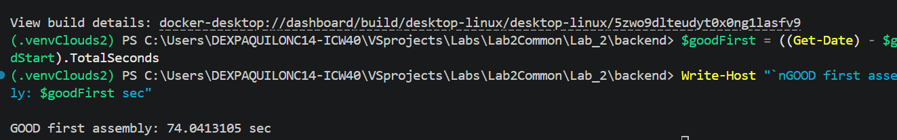

Как видно, теперь сборка образа занимает 74 секунды, что примерно в 4 раза меньше, чем у нас было на плохом докерфайле. Проверим теперь рвзмер. Печатаем:

```shell
docker images | Select-String "notes-backend"
```
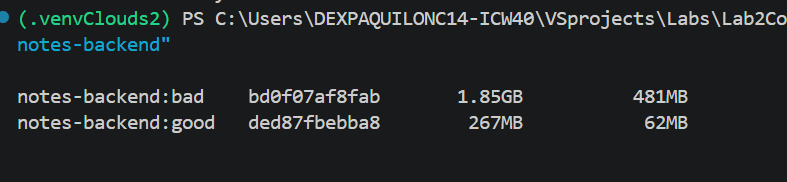

Видно, что размер уменьшился примерно в 7 раз. Проверим пользовательские права образа. В плохом образе каждый шел как рут - посмотрим, как с этой задачей справится хороший докер.
```shell
docker compose up -d backend
docker compose exec backend whoami
docker compose exec backend id
```
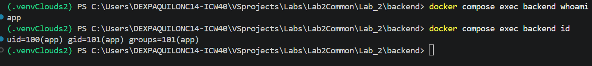

Пользователь - не рут. Изменим одну строчку кода и снова запустим build.

```shell
Add-Content -Path run.py -Value"`n# cache test" 
$s = Get-Date
docker build -f dockerfile.good_backend -t notes-backend:good .
$goodRe = ((Get-Date) - $s).TotalSeconds
Write-Host "GOOD rebuild: $goodRe sec"
```
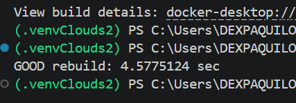

Видно, что теперь после изменения вместо 80 секунд компиляция занимает 5. Проверим, что docker compose up запускает три наших сервиса вместе.

```shell
docker compose down
docker compose up -d
Start-Sleep -Seconds 30
docker compose ps
```
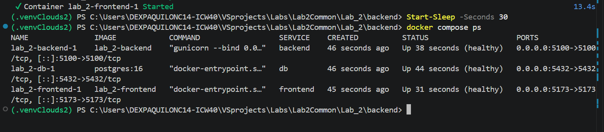

Проверим общение сервисов между собой. Но сначала применим миграции.
```shell
docker compose exec backend flask db upgrade 
curl http://localhost:5100/api/notes
curl http://localhost:5173
docker compose exec frontend sh -c "wget -qO- http://backend:5100/api/notes"
```

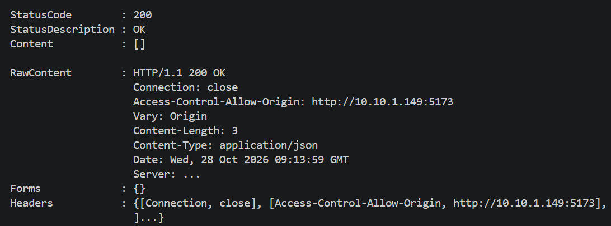
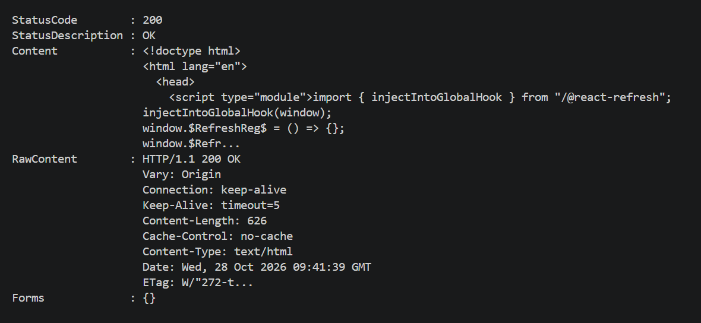
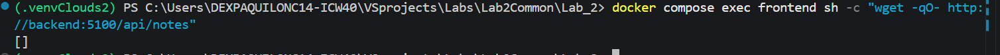
Все три сервиса общаются между собой: frontend обращается к backend по внутреннему имени http://backend:5100, backend обращается к db по postgresql://db:5432. С хоста доступны localhost:5100 (backend) и localhost:5173 (frontend).
```shell
Invoke-RestMethod -Uri "http://localhost:5100/api/notes" `
  -Method Post `
  -ContentType "application/json" `
  -Body '{"title": "Persistent Test", "content": "Should survive"}'
curl http://localhost:5100/api/notes
docker compose rm -sf db
docker ps -a | Select-String "db"
docker volume ls | Select-String "postgres_data"
docker compose up -d db
curl http://localhost:5100/api/notes
```

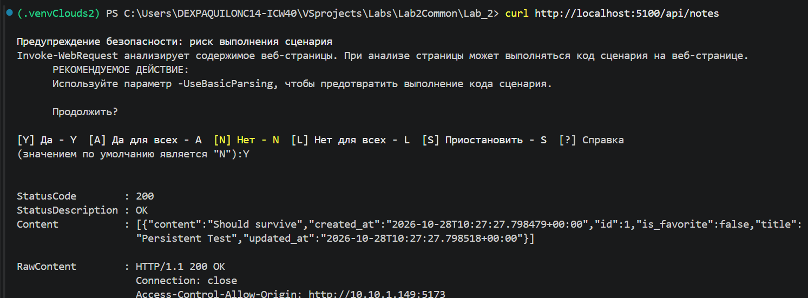
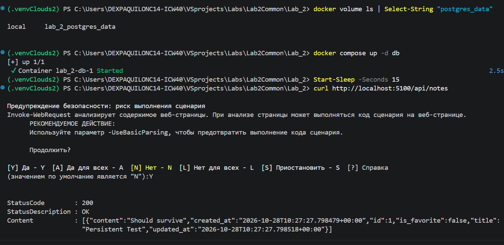
Данные PostgreSQL хранятся в именованном томе postgres_data. После docker compose rm -sf db контейнер удалён, но том остался. После docker compose up -d db заметка сохранилась — данные не потерялись.

Проверим сетевую изоляцию.
```bash
docker compose exec backend python -c "import socket; s = socket.create_connection(('db', 5432), timeout=3); print('SUCCESS: Backend connected to DB'); s.close()"
docker compose exec frontend node -e "const net = require('net'); const client = net.createConnection({ host: 'db', port: 5432 }, () => { console.log('FAIL: Frontend CAN connect to DB'); client.end(); }); client.on('error', (err) => { console.log('SUCCESS: Frontend CANNOT connect to DB. Error:', err.code); });"
```
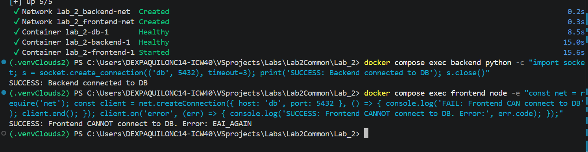

Попытка frontend достучаться до db:5432 завершается ошибкой ENOTFOUND (хост не найден), что доказывает сетевую изоляцию.

## Звездочка

### Самовосстановление 

Внесем изменения в ```compose.yml```. 

Для сервиса ```db```:

```yaml
healthcheck:
    test: [ "CMD-SHELL", "pg_isready -U postgres -d notes_service" ]
    interval: 5s
    timeout: 3s
    retries: 10
    start_period: 10s
restart: unless-stopped
```
Каждые 5 секунд проверяем, готова ли PostgreSQL принимать подключения. Ожидание ответа - не более 3 секунд. Количество неудачных проверок до статуса ```unhealthy``` - 10. Начальный период запуска - 10 секунд.

Для сервиса ```backend```:

```yaml
depends_on:
    db:
        condition: service_healthy

healthcheck:
    test:
        - CMD
        - python
        - -c
        - "import urllib.request; urllib.request.urlopen('http://127.0.0.1:5100/health', timeout=2)"
    interval: 10s
    timeout: 3s
    retries: 5
    start_period: 15s

restart: unless-stopped
```
Бэкенд будет запускаться после того, как проверка БД подтвердит её готовность. Его собственный ```healthcheck``` проверяет, отвечает ли маршрут ```/health```.

Для сервиса ```frontend```:

```yaml
depends_on:
    backend:
        condition: service_healthy

healthcheck:
    test:
        - CMD
        - node
        - -e
        - "fetch('http://127.0.0.1:5173/').then(r => { if (!r.ok) process.exit(1) }).catch(() => process.exit(1))"
    interval: 15s
    timeout: 5s
    retries: 5
    start_period: 20s

restart: unless-stopped
```
Здесь ```frontend``` ожидает готовности бэкенда, проверяет доступность своей страницы и автоматически перезапускается при завершении контейнера.

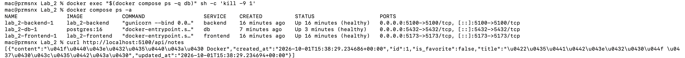

Как можно увидеть на скриншоте, БД восстанавливается после того, как мы ее "погасили".
### Лимиты под нагрузкой

Впишем лимиты для бэкэнда в yaml - 

```yaml
    deploy:
      resources:
        limits:
          cpus: '0.50'     # Лимит: половина ядра
          memory: 64M    
```
Запустим пересборку бэкэнда, запустим docker compose up и параллельно откроем docker stats. Чтобы нагрузить наш бэк, завалим его ГЕТ-запросами серез еще одну консоль.
```bash
while ($true) { 
  try {
      Invoke-RestMethod -Uri "http://localhost:5100/api/notes" -Method Get -TimeoutSec 2 | Out-Null} 
      catch {
       Write-Host "Ошибка: Сервер не отвечает" -ForegroundColor Red}}
```
Будем менять значение и смотреть, что будет.
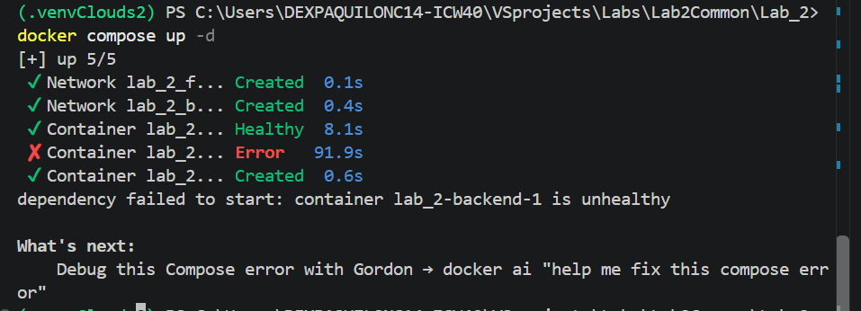
На 32 МБ сервис даже не смог подняться нормально - воркеры Gunicorn принудительно завершаются ядром системы (SIGKILL) примерно через 10–15 секунд после старта.
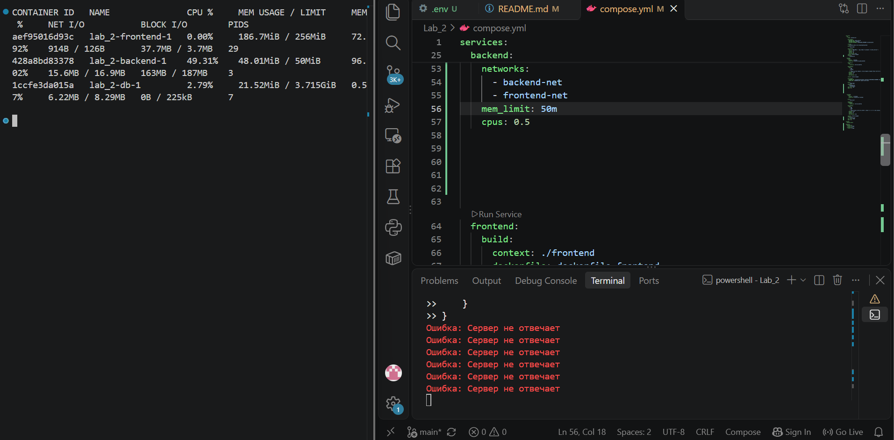
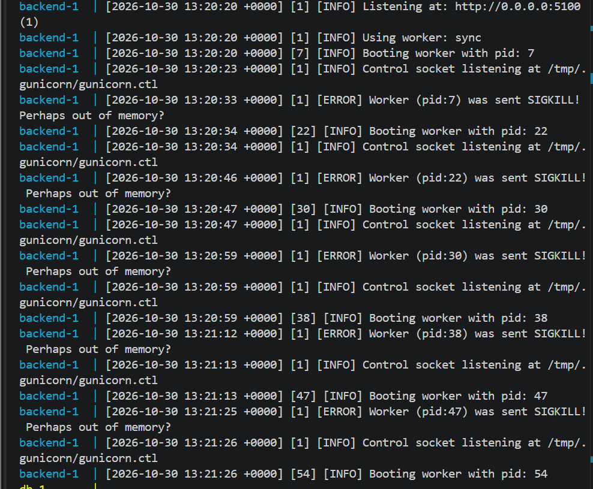
На 50 МБ уже получше - сервис запускается, но то падает, то встает, так как памяти не хватает.
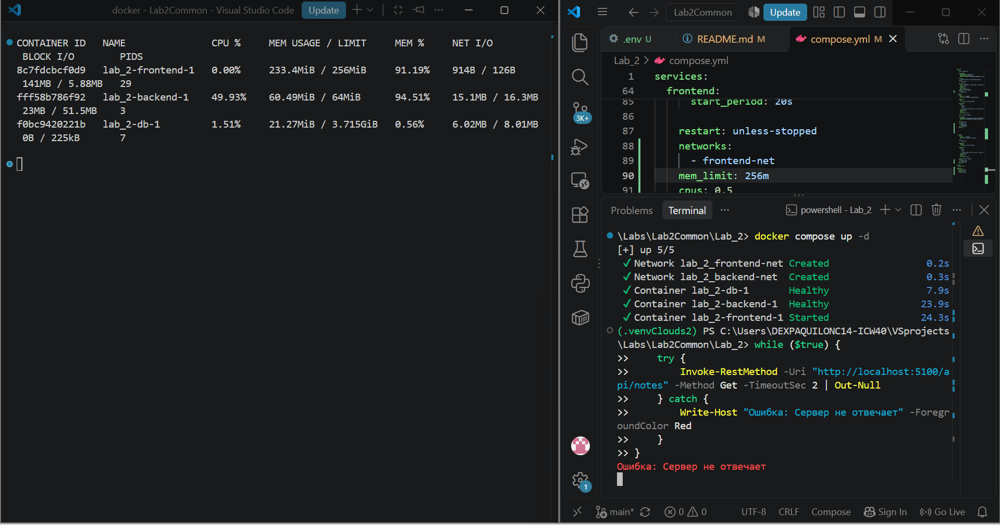
На 64 МБ сервис уже начинает выдавать из себя подобине нормальной работы, но явно задыхается и время от времени падает.
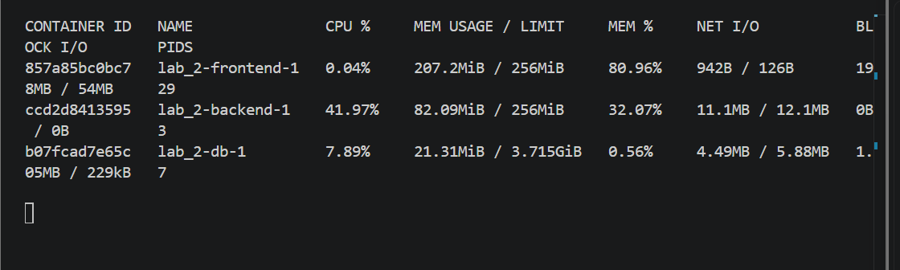

На 256 МБ сервис работает нормально, и у него есть пространство резерва.

В итоге наше чудо из Python + Gunicorn + Flask + SQLAlchemy требует минимум 80–100 МБ только для инициализации, а лимит в 50 МБ = сработает OOM Killer при попытке обработать первый healthcheck-запрос. После увеличения лимита до 256 МБ (mem_limit: 256m) и выделения одного ядра CPU сервис успешно прошел healthcheck, и весь стек поднялся.
Продолжим мучать наши заметки на фронте. Его мы будем пытать бесконечным curl фронта. У нас стоит Node.js и Vite. Фишка последнего - кэширование и гибкий "ленивый" подход к памяти, так что уронить его будет задачей посложнее, чем с бэком.

```bash
 while ($true) { curl.exe -s http://localhost:5173/ > $null }
```
На 64 МБ наш фронт был все еще жив, так что пришлось перейти к тяжелой артиллерии - 32 МБ.
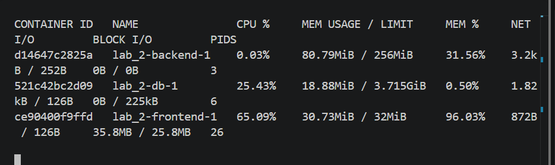

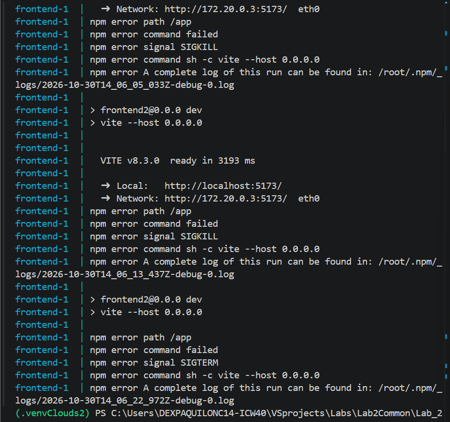
Ну, очевидно, SIGKILL не позволяет сервису нормально запуститься, даже Node.js не идет. Попробуем 100 МБ и 256.
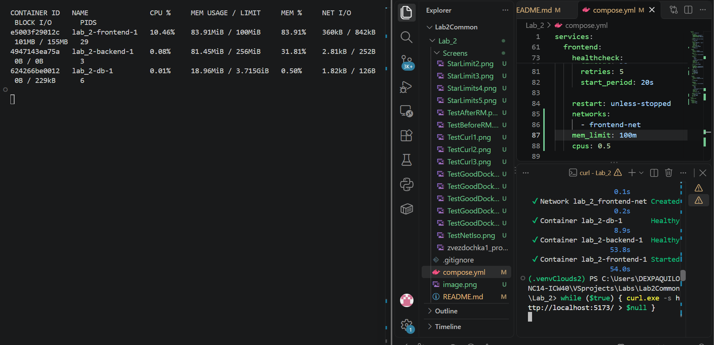
Сотка - неплохо, но все еще мало воздуха.

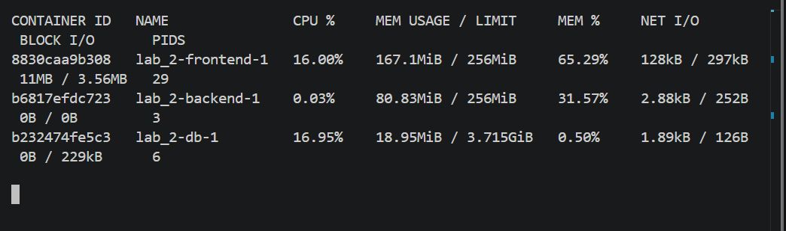

Для стабильной работы фронтенда был установлен лимит в 256 МБ, при котором он потребляет около 173 МБ (67%), оставляя запас для кэширования.
Теперь займемся базой данных.  Нагрузим нашу БДшку.
```bash
> while ($true) {                       
>>     try {          
>>         $body = @{ title = "Load Test"; content = "Data $(Get-Random)" } | ConvertTo-Json
>>         Invoke-RestMethod -Uri "http://localhost:5100/api/notes" -Method Post -ContentType "application/json" -Body $body -ErrorAction SilentlyContinue | Out-Null
>>     } catch {} 
```

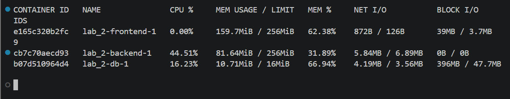
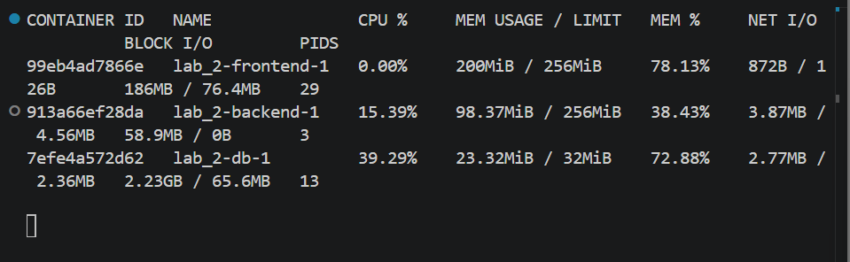

Постгрес оказался самым стрессоустойчивым. В отличие от бэка и фронта, он не падал намертво при ужасных лимитах (16–32 МБ). Но это все равно кошмарный сценарий - PostgreSQL при нехватке оперативной памяти не может кэшировать данные и начинает использовать жесткий диск как временное хранилище - проще говоря, если бы это был реальный сервис заметок, из-за этого сайт бы тащился как питон по Дусту. При лимитах 16 и 32 МБ так и случилось - оперативки катастрофически не хватало, PostgreSQL все время бегает к жесткому диску. В docker stats: память занимает 9-21 МБ (60–70%), а показатель BLOCK I/O (объем чтения/записи с диска) взлетает до 155 МБ. При пиковых нагрузках - аж до 2.23 ГБ.
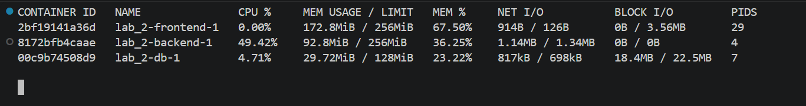
Давайте тогда попробуем 128 МБ. Получилось!!! База данных перестала «мучить» диск, закэшировала нужные данные в оперативной памяти и стала работать стабильно и быстро.

Итак, мы нашли лимиты - для БД = 128 МБ, для бэка и фронта = по 256 МБ.


