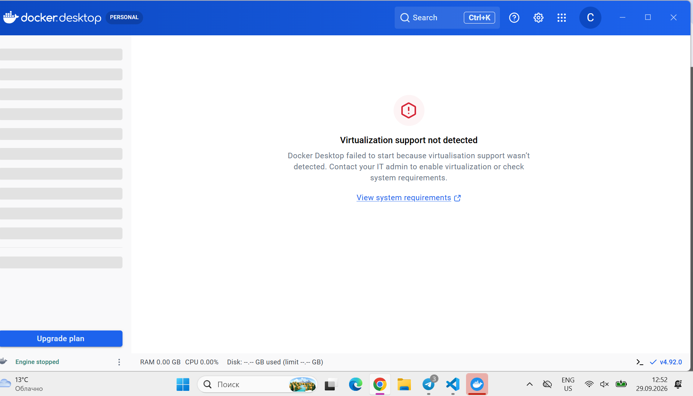
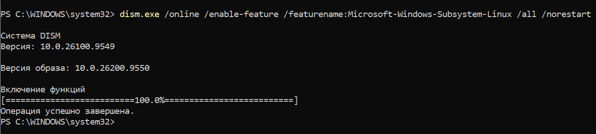
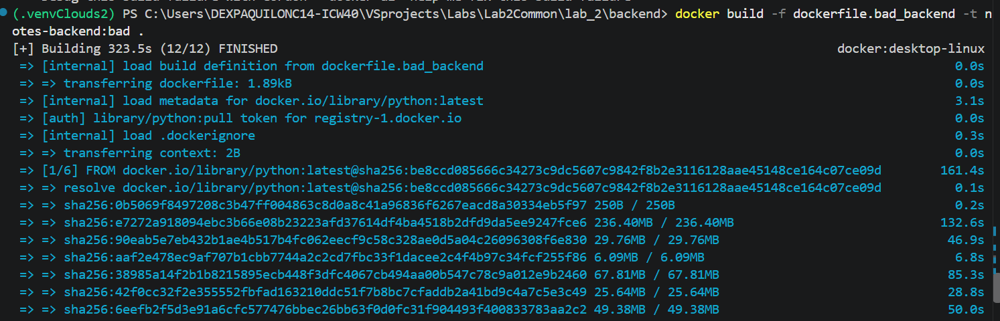
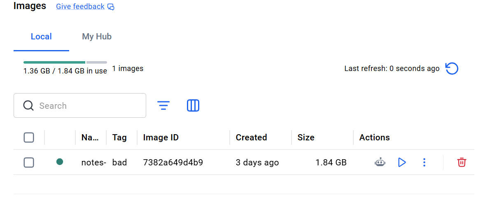
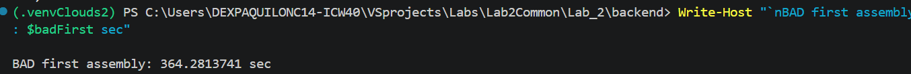
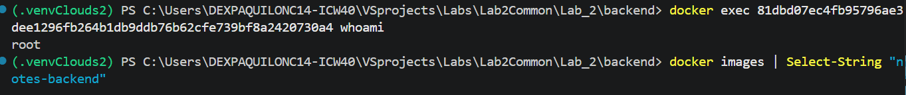
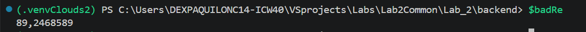

# Лабораторная работа 2
## День 1
Итак, в этой лабораторной перед нами стояла задача завернуть сервис из лабы 1 в докер и поднять его. Но ради этого сначала нужно было поставить докер. Как это просто - подумали мы. Как бы не так - ответил Докер. 



Оказалось, что Докер работает на основе Windows Subsystem for Linux - WSL2. И чтобы поставить Докер, нужно правильно поставить WSL (качаем файл wsl_update_x64.msi с сайта Microsoft). ТА также включить на компьютере компоненты виртуализации нужные для работы подсистемы, так как Докер стоит на легкой виртуальной машине внутри которой Линукс. Это было сделано командой ниже -



Дальше, после того, как была отпразднована успешная установка Докера, был написан плохой докерфайл. Так как у нас бэк и фронт - два отдельных сервиса, общающихся между собой по установленному порту, то для них были написаны два разных докерфайла. Мы решили продемонстрировать bad practices и исправить их на докерфайле бэкэнда. Так было сделано из-за того, что фронт — это статика, и большинство bad practices (слои, кеш зависимостей, multi-stage для компиляции) к нему не применяются. Выбранные Bad Practices в основном заавязаны на одной чудесной привычке докера - он запускает снова команду, только если либо изменилась сама команда, либо если до команды что-то изменилось. Если это не так, то он просто берет то, что лежит у него в кэше. А лежать там может разное, в том числе и не очень хорошое. Вот как выглядел плохой файл:

```dockerfile
FROM python:latest
WORKDIR /app
COPY . .
RUN apt-get update 
RUN apt-get install -y curl vim git build-essential libpq-dev
RUN pip install -r requirements.txt
ENV DATABASE_URL=postgresql+psycopg://postgres:yourpassword@db:5432/notes_service
ENV SECRET_KEY=super-secret-123
ENV POSTGRES_PASSWORD=yourpassword
EXPOSE 5100
CMD flask --app run.py run --port 5100
```
Первая плохая практика - не указывать версию питона. Это плохо, так как это значит, если "самая новая" версия питона по мнению Докера изменится (а она обязательно изменится), то код программы может не запуститься из-за устаревания. 

Вторая плохая практика - копировать абсолютно ВСЕ, что докер видит внутрь контейнера, даже такие ненужные вещи как .gitignore, .env, .venv и прочие интересные вещи, ибо .dockerignore в момент написания bad practices не бьло. (3 строчка)

Третья - просто убийственная связка get-update (берет список свежих пакетов просто и передает вниз установщику) и install (берет версии из списка и ставит). Порочный круг завязан на той самой чудесной привычке Докера заново перезапускать команду только в определенных случаях. Ужас начинается так: мы написали наше приложение заметок и забыли о нем на год. А через год вернулись и решили добавить потрясных новых фич, ради которых добавили в инсталл еще 1 новый пакет. Запускаем докер. Докер смотрит на команду апдейта. Команда сама не изменилась, до нее не изменилось ничего. Значит, решает он, еще раз запускать не будем. Инсталл в кои веки запускается и берет из листа выше версии пакетов. Пытается их скачать, но тщетно, ибо те самые старые версии пакетов больше не поддерживаются и их нету нигде. Ура, все упало! 

Четвертая - использование пип инсталл ПОСЛЕ копирования всего кода. Так как Докер работает слоями, то изменение одной-единственной строчки кода (!) будет считано как изменение в самом нижнем слое и Докер перезапустит все после него - значит, пип инсталл будет заново происходить после КАЖДОГО изменения кода.

Пятая - гениальное решение выставить на всеобщее обозрение ключей-паролей от Постгрес. Для верности записав их конечно в ENV, чтобы любой более-менее сведущий пользователь мог откопать их в кэше Докера через docker inspect + docker history после того, как кто-то, ужаснувштсь, их сотрет из докерфайла. 

Шестая - безобидно выглядящая последняя строчка на самом деле - вишенка на торте саботажа. Эта строчка написана так, что бедному Докеру придется запускать приложение не напрямую, а через shell. Выглядит это так - Докер разворачивает Шелл, а Шелл разворачивает Флэск. Можно было бы подумать, что все на этом благополучно работает, и слава богу, но сработает оно ровно один раз. До первой остановки Докера.
Остановим Докер. У Докера есть 2 протокола остановки - SIGTERM ("стоп по-хорошему") и SIGKILL (стоп по-плохому). По умолчанию Докер посылает своему процессу номер 1 сначала SIGTERM, ждет 10 секунд и кидает SIGKILL. А при последней команде процесс № 1 для него - это Шелл, а не сам Флэск. Итак, Докер говорит Шеллу остановиться корректно, ждет 10 секунд и все грубо закрывает, если он отказывается останавливаться. А Шелл Флэску команду остановиться не передаст, а значит, флэск будет крутиться.
И значит, все будет обречено на скоропостижную смерть через 10 секунд по SIGKILL. Прощайте, данные из БД и прочие изменения, подлежащие сохранению. 

Седьмая - К тому же, приложение из=за последней строчки просто не будет работать корректно. Из-за той же привязки к Шелл, порт, проброшеный в докере, просто не дойдет до Флэска, т.к. по умолчанию порт, на котором слушает Флэск не совпадает с портом Докера.

Запускаем командой из терминала -
```shell
cd backend
docker build -f dockerfile.bad_backend -t notes-backend:bad .  
```



Сделаем замеры по времени и памяти, чтобы потом сравнить с хорошим файлом.  

```shell
$badStart = Get-Date
docker build -f dockerfile.bad_backend -t notes-backend:bad . 
$badFirst = ((Get-Date) - $badStart).TotalSeconds
Write-Host "`nBAD first assembly: $badFirst sec" 
```
Плохой докерфайл, конечно, плохой, но в принципе запускается, хотя его сборка занимает устрашающие 5 минут и 1.8 GB (!!!) памяти.




Исправим одну строчку кода в run.py - добавим комментарий и замерим время.

```shell
$s = Get-Date
docker build -f dockerfile.bad_backend -t notes-backend:bad . 
$badRe = ((Get-Date) - $s).TotalSeconds
Write-Host "`nBAD second assembly: $badRe sec" 
```


89 секунд с кэшем - неплохо. Далее был написан хороший Докерфайл.

```dockerfile
FROM python:3.14-slim
WORKDIR /app
COPY requirements.txt .
RUN pip install --no-cache-dir -r requirements.txt
COPY . .
EXPOSE 5100
CMD ["gunicorn", "--bind", "0.0.0.0:5100", "run:app"]
```

Что же в нем хорошего? Во-первых, используется облегченную версию Python 3.14 (так как она занимает меньше места) и фиксированная версия вместо latest обеспечивает воспроизводимость. 
Во-вторых, копируется только файл requirements.txt перед pip install, а не весь код - значит, из-за одной измененной строки весь пип не пойдет с самого начала. (Docker использует кэш слоя pip install, и при изменении кода зависимости не переустанавливаются) В строке с пип инсталл есть --no-cache-dir - эта строка сообщает, что сохранять кэш пипа в докер-образе не нужно, что существенно уменьшает размер. В-третьих, приложение запускается через Gunicorn - это сервер для веб-приложений. Он многопоточный и решает проблему с SIGTERM\SIGKILL Докера, так как перестает принимать новые запросы после SIGTERM, за 30 секунд дает идущим процессам завершиться и корректно закрывает БД. 
В-четвертых, используется форма EXEC всесто SH в самом докерфайле - это значит, что Докер общается с Gunicorn напрямую, не через Shell. Плюсом прописан порт 0.0.0.0:5100, что значит, что сервер совместим с сетевым интерфейсом Докера. В-пятых - apt get update + apt get install вообще не используются.

Дальше также был написан хороший докерфайл для фронтенда -
```dockerfile
FROM node:22-alpine
WORKDIR /app
COPY package*.json ./
RUN npm ci
COPY . .
EXPOSE 5173
CMD ["npm", "run", "dev", "--", "--host", "0.0.0.0"]
```

Всё начинается с выбора базового образа node:22-alpine - он занимает около 130 МБ вместо гигабайта у полных версий. Следующая строка COPY package*.json ./ копирует с  компьютера только файлы package.json и package-lock.json, но не весь код целиком. 
Это делается специально для того, чтобы использовать кэширование слоёв Docker: если зависимости не менялись, а изменился только код, Docker возьмёт слой с установкой зависимостей из кэша и не будет пересобирать его заново.
Затем идет команда установки зависимостей, которая читает package-lock.json и ставит точные версии пакетов. Плюсом это  быстрее, чем обычный npm install. Наконец, последняя строчка - запускается npm-скрипт dev,  Vite слушает все сетевые интерфейсы, а не только локальный localhost.Здесь используется exec-форма, что предотвращает грустные пререкания с Шэллом из-за SIGTERM+SIGKILL (описано выше).


<details>

<summary>Еще мы добавили.dockerignore для Бэкэнда и Фронтэнда</summary>
 В плохом образе одной из BAD practice было то, что .dockerignore не использовался при сборке образа.Файл .dockerignore определяет, какие файлы и папки не попадают в контекст сборки Docker. Без него Docker упаковывает все, что видит. .dockerignore обеспечивает нам следующее: 
 <ul>
    <li>быстрая сборка, т.к. контекст в 10–100 раз меньше </li>
    <li>маленький образ, т.к. копируется только нужный код </li>
    <li>безопасность т.к. секреты не попадают в образ  </li>
    <li> работающий кэш т.к. COPY . . инвалидируется только при изменении кода.</li>
 </ul>

Для бэка -

```
.env
.venv
venv
__pycache__
*.pyc
.idea
.git
.gitignore
```
Для фронта -
```
node_modules
dist
.git
.gitignore
.DS_Store
```
</details>


<details>

<summary>Также был написан compose.yml</summary>

```yml
services:
  db:
    image: postgres:16

    environment:
      POSTGRES_DB: notes_service
      POSTGRES_USER: postgres
      POSTGRES_PASSWORD: yourpassword

    volumes:
      - postgres_data:/var/lib/postgresql/data

  backend:
    build:
      context: ./backend
      dockerfile: dockerfile.good_backend

    environment:
      DATABASE_URL: postgresql+psycopg://postgres:yourpassword@db:5432/notes_service
      SECRET_KEY: super-secret-123

    ports:
      - "5100:5100"

    depends_on:
      - db

  frontend:
    build:
      context: ./frontend
      dockerfile: dockerfile.frontend

    ports:
      - "5173:5173"

    depends_on:
      - backend

volumes:
  postgres_data:
```
</details>


