### Лимиты под нагрузкой

Впишем лимиты для бэкэнда в yaml - 

```yaml
    deploy:
      resources:
        limits:
          cpus: '0.50'     # Лимит: половина ядра
          memory: 64M    
```
Запустим пересборку бэкэнда, запустим docker compose up и параллельно откроем docker stats. Чтобы нагрузить наш бэк, завалим его ГЕТ-запросами серез еще одну консоль.
```bash
while ($true) { 
  try {
      Invoke-RestMethod -Uri "http://localhost:5100/api/notes" -Method Get -TimeoutSec 2 | Out-Null} 
      catch {
       Write-Host "Ошибка: Сервер не отвечает" -ForegroundColor Red}}
```
Будем менять значение и смотреть, что будет.
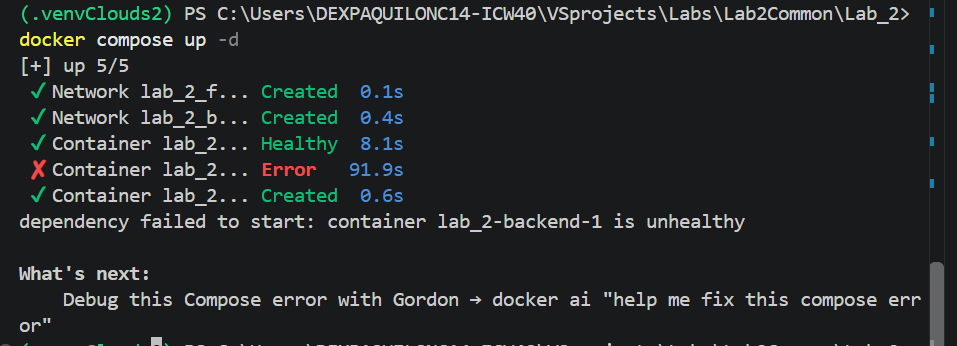
На 32 МБ сервис даже не смог подняться нормально - воркеры Gunicorn принудительно завершаются ядром системы (SIGKILL) примерно через 10–15 секунд после старта.
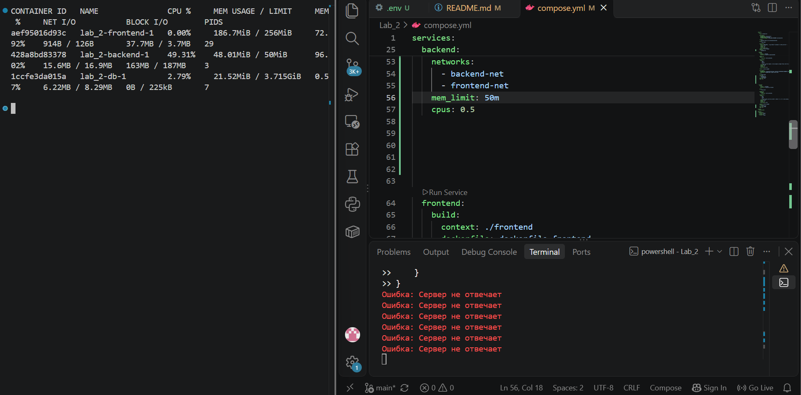
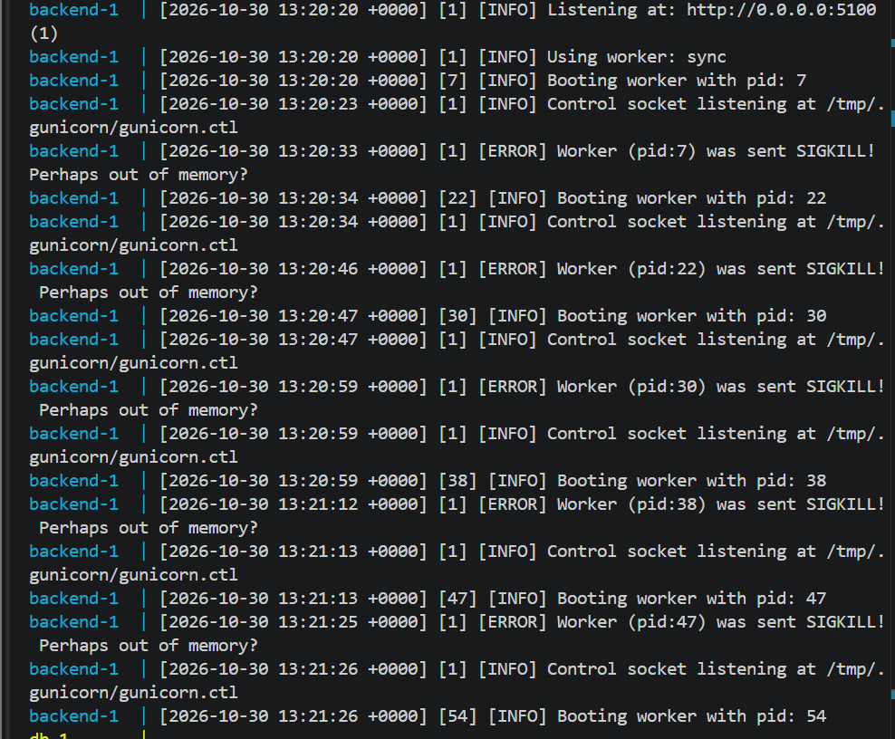
На 50 МБ уже получше - сервис запускается, но то падает, то встает, так как памяти не хватает.
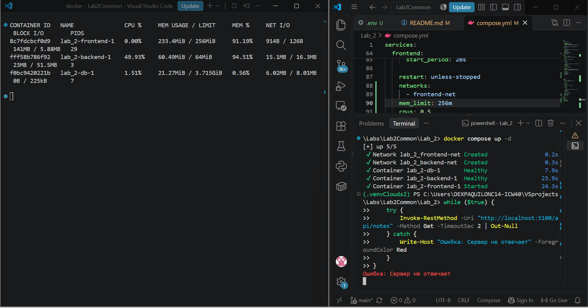
На 64 МБ сервис уже начинает выдавать из себя подобине нормальной работы, но явно задыхается и время от времени падает.
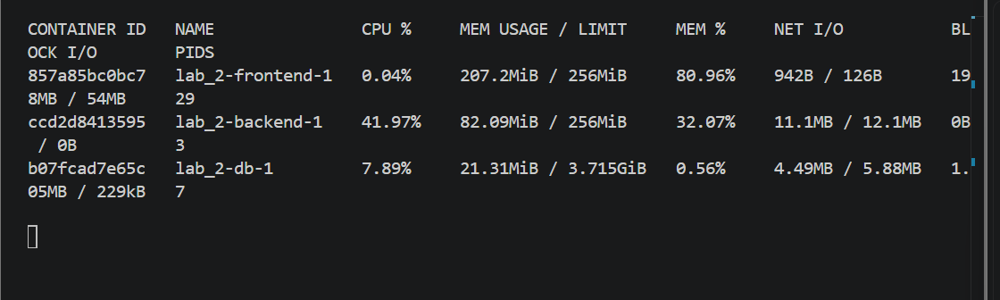

На 256 МБ сервис работает нормально, и у него есть пространство резерва.

В итоге наше чудо из Python + Gunicorn + Flask + SQLAlchemy требует минимум 80–100 МБ только для инициализации, а лимит в 50 МБ = сработает OOM Killer при попытке обработать первый healthcheck-запрос. После увеличения лимита до 256 МБ (mem_limit: 256m) и выделения одного ядра CPU сервис успешно прошел healthcheck, и весь стек поднялся.
Продолжим мучать наши заметки на фронте. Его мы будем пытать бесконечным curl фронта. У нас стоит Node.js и Vite. Фишка последнего - кэширование и гибкий "ленивый" подход к памяти, так что уронить его будет задачей посложнее, чем с бэком.

```bash
 while ($true) { curl.exe -s http://localhost:5173/ > $null }
```
На 64 МБ наш фронт был все еще жив, так что пришлось перейти к тяжелой артиллерии - 32 МБ.
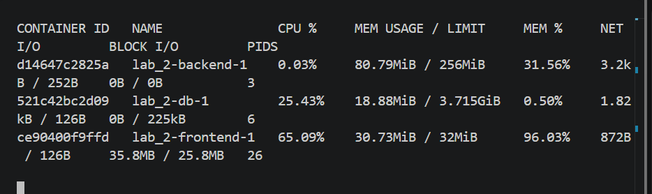

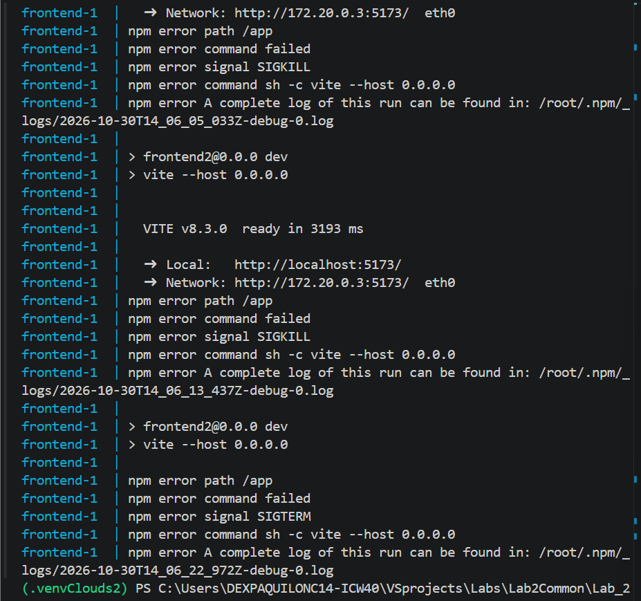
Ну, очевидно, SIGKILL не позволяет сервису нормально запуститься, даже Node.js не идет. Попробуем 100 МБ и 256.
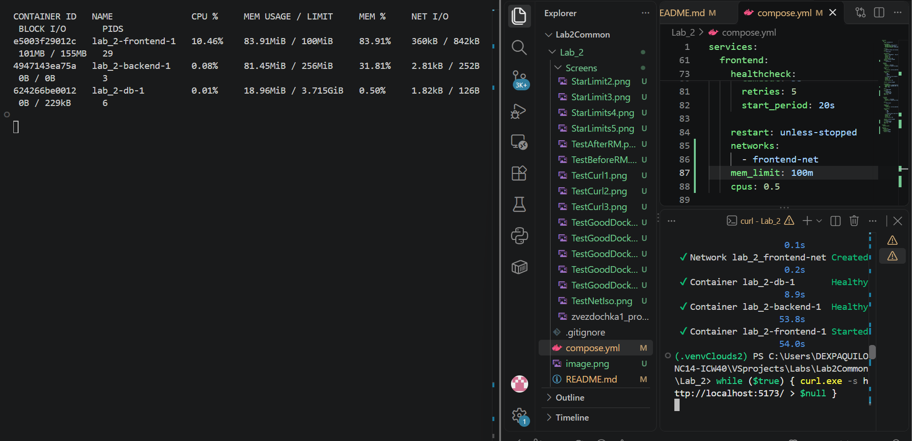
Сотка - неплохо, но все еще мало воздуха.

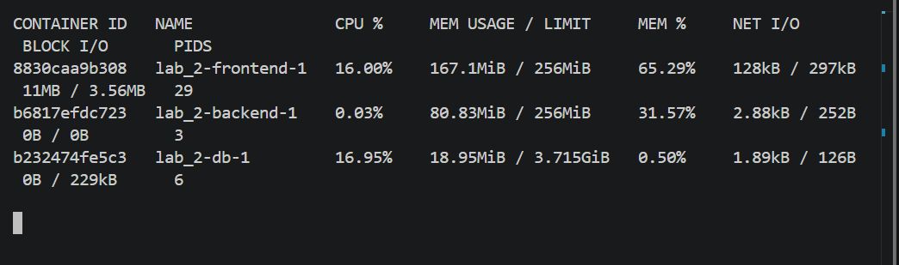

Для стабильной работы фронтенда был установлен лимит в 256 МБ, при котором он потребляет около 173 МБ (67%), оставляя запас для кэширования.
Теперь займемся базой данных.  Нагрузим нашу БДшку.
```bash
> while ($true) {                       
>>     try {          
>>         $body = @{ title = "Load Test"; content = "Data $(Get-Random)" } | ConvertTo-Json
>>         Invoke-RestMethod -Uri "http://localhost:5100/api/notes" -Method Post -ContentType "application/json" -Body $body -ErrorAction SilentlyContinue | Out-Null
>>     } catch {} 
```

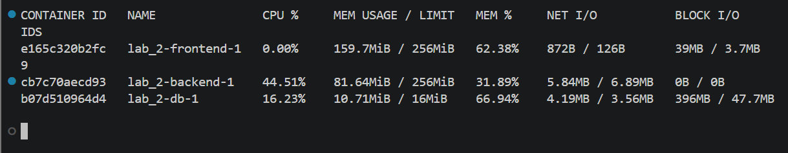
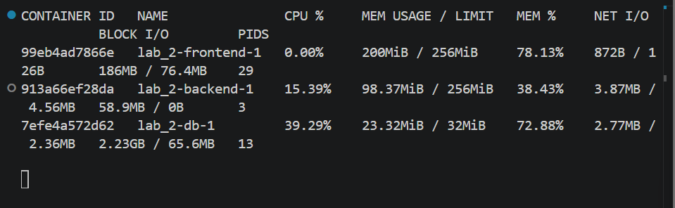

Постгрес оказался самым стрессоустойчивым. В отличие от бэка и фронта, он не падал намертво при ужасных лимитах (16–32 МБ). Но это все равно кошмарный сценарий - PostgreSQL при нехватке оперативной памяти не может кэшировать данные и начинает использовать жесткий диск как временное хранилище - проще говоря, если бы это был реальный сервис заметок, из-за этого сайт бы тащился как питон по Дусту. При лимитах 16 и 32 МБ так и случилось - оперативки катастрофически не хватало, PostgreSQL все время бегает к жесткому диску. В docker stats: память занимает 9-21 МБ (60–70%), а показатель BLOCK I/O (объем чтения/записи с диска) взлетает до 155 МБ. При пиковых нагрузках - аж до 2.23 ГБ.
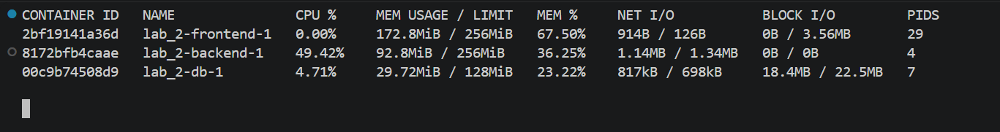
Давайте тогда попробуем 128 МБ. Получилось!!! База данных перестала «мучить» диск, закэшировала нужные данные в оперативной памяти и стала работать стабильно и быстро.

Итак, мы нашли лимиты - для БД = 128 МБ, для бэка и фронта = по 256 МБ.


